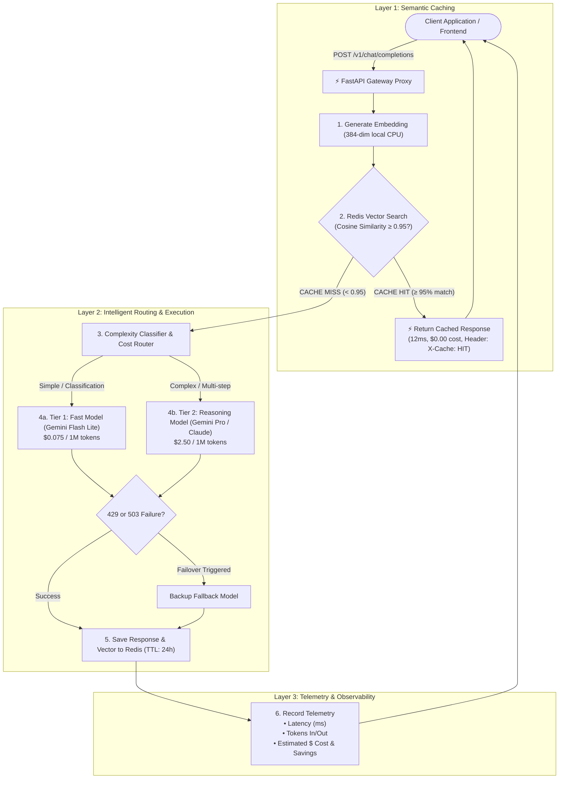

# ⚡ Semantic LLM Gateway & Caching Proxy: Master Project Context & Spec

## 👤 Developer Profile & Target
- **Developer:** Noor Ullah
- **Background:** Senior Frontend Engineer (4+ years) transitioning to **Production AI Engineer**.
- **Portfolio Track:** Project #2 of 3 (Project #1 completed: `deep-research-crag`).
- **Target Goal:** Land a Remote AI Engineer / AI Platform Engineer role ($3,000 – $5,000 / month).
- **Core Stack:** Python 3.12, FastAPI (Async), Redis Vector Search, Google Gemini Flash / Pro, LiteLLM, Pydantic v2, Docker, React.

---

## 🎯 Executive Summary & Mission

### What is this project?
**`semantic-llm-gateway`** is an enterprise-grade AI proxy microservice designed to sit between client applications and frontier LLM providers (Google Gemini, OpenAI, Anthropic). 

It acts as an intelligent traffic controller that:
1. **Slashes LLM API Costs by 40%–70%**: Uses vector similarity caching in Redis to serve semantically identical queries in **< 15ms at $0.00 cost**.
2. **Eliminates 429 Rate-Limit Outages**: Features automated fallback routing across backup models and providers.
3. **Routes by Query Complexity**: Sends simple queries to lightweight, ultra-cheap models ($0.075 / 1M tokens) and reserves expensive frontier models ($2.50 / 1M tokens) strictly for complex reasoning.
4. **Provides Full Tokenomics Observability**: Exposes real-time metrics on dollar costs saved, token budgets, latency percentiles (p50, p95, p99), and cache hit ratios.

---

## 🏢 The Enterprise Problem We Are Solving

When companies scale AI features in production, they hit three critical roadblocks:
1. **Cost Inefficiency**: 30% to 50% of user prompts are semantically repetitive (*"How do I reset my password?"* vs *"Steps to reset password"*). Standard exact-string caching fails, costing thousands in duplicate API calls.
2. **Latency Bottlenecks**: Calling frontier LLMs over the internet takes 1.5s to 4s. A local semantic cache hit returns in **10ms to 20ms**, dramatically improving user experience.
3. **Provider Outages & Throttling**: Direct API integrations crash when rate limits (HTTP 429) or upstream server errors (HTTP 503) trigger. An enterprise gateway provides transparent failover.

---

## 🏗️ Architecture & Data Flow



---

## 📚 Core Terminology & Mental Models

| Term | Definition & Enterprise Application |
| :--- | :--- |
| **Exact Cache vs. Semantic Cache** | Exact string caching matches identical characters. Semantic caching embeds the text into a vector space and measures mathematical cosine angle (meaning). Matches variations like *"best laptop for code"* and *"top programming laptop"*. |
| **Similarity Threshold ($\tau$)** | The cosine similarity cutoff (e.g. `0.95` or `0.96`). Scores $\ge \tau$ are confident enough to serve from cache; scores $< \tau$ trigger a model generation to prevent stale/inaccurate answers. |
| **Complexity-Based Routing** | Using a fast, deterministic classifier to separate cheap tasks (sentiment, simple lookup) from heavy cognitive tasks (code architecture, mathematical reasoning). |
| **OpenAI-Compatible API** | Structuring the gateway endpoint to match `/v1/chat/completions` format. This allows any existing software (LangChain, Cursor, mobile apps) to use this gateway simply by changing `base_url="http://localhost:8000/v1"`. |
| **Tokenomics & Cost Delta** | Tracking cost calculations: $\text{Savings} = (\text{Tokens}_{\text{cached}} \times \text{Price}_{\text{frontier}}) - \$0.00$. |

---

## 🗺️ The 7-Step Step-by-Step Implementation Roadmap

```
Step 1: The Semantic Hashing & Similarity Engine (cache_engine.py)
        - Vector embeddings via BAAI/bge-small-en-v1.5
        - Cosine similarity threshold evaluator and prompt normalization

Step 2: The Redis Vector Cache Store with Local Fallback (cache_store.py)
        - Redis vector search index (RediSearch) with TTL expiration
        - In-memory vector cache fallback for zero-dependency development

Step 3: Complexity-Based Model Router & Token Cost Calculator (router.py)
        - Intent/complexity classifier routing to Tier 1 vs Tier 2 models
        - Exact token counting and cost attribution formula

Step 4: Multi-Provider Client & Automatic 429 Failover (providers.py)
        - Primary: Gemini Flash Lite / Gemini Pro
        - Automated failover fallback on 429 (Rate Limit) or 503 (Overload)

Step 5: OpenAI-Compatible FastAPI Gateway with Streaming (main.py)
        - Async POST /v1/chat/completions endpoint
        - Headers: X-Cache (HIT/MISS), X-Latency-MS, X-Cost-USD
        - Server-Sent Events (SSE) streaming support

Step 6: Real-Time Telemetry & Cost-Savings Metrics (telemetry.py)
        - Metrics: Cache Hit Ratio, Total Tokens Saved, Dollar Cost Avoided, Latency p50/p95
        - Prometheus / JSON endpoint at /metrics

Step 7: The Live Visual Operations Dashboard (frontend/)
        - React + TypeScript + Tailwind UI
        - Live traffic waterfall, token savings counter, and real-time cache analytics
```

---

## 🤝 Pair-Programming & Learning Protocol

To maximize deep learning and interview mastery, every step in this project follows this strict structure:
1. **One Step at a Time:** Focus on a single module until verified.
2. **The Brief (Why & Purpose):** What production problem this specific code solves.
3. **The Technology Brief:** Deep architectural explanation of the libraries, math, and data structures.
4. **Complete Code Snippet:** Fully commented, production-grade code (no incomplete placeholders).
5. **Code Walkthrough:** Line-by-line explanation of core functions.
6. **Standalone Verification:** A self-contained test script in `if __name__ == "__main__":` runnable directly via terminal.
